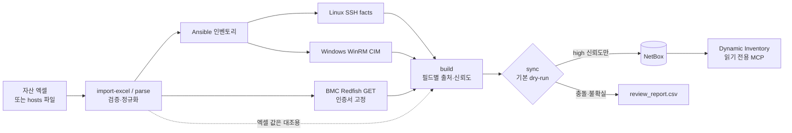

# asset-sync

**자산 엑셀(또는 hosts 파일)을 출발점으로 서버 정보를 읽기 전용으로 수집·검증하고, 확인된 값만 NetBox에 멱등하게 등록하는 IT 자산 동기화 도구**

> 이 저장소는 포트폴리오용 데모입니다. 실제 사내 환경(서버 수십 대, HPE iLO / AMI / Dell iDRAC)에 적용한 경험을 바탕으로 만들었고,
> 저장소의 모든 데이터는 **가상의 회사 "데모클라우드"** 기준으로 새로 만든 가짜 데이터입니다.
> IP는 문서용 예약 대역(RFC 5737), 시리얼은 `DEMO…` 형식이며, 실제 조직이나 장비와 관련이 없습니다.

---

## 해결하려는 문제

현업 자산 엑셀은 사람이 손으로 관리합니다. 그래서 다음과 같은 일이 흔합니다.

- hostname 칸에 이름 대신 설명이 적혀 있음 (`AHV 클러스터 노드 1`)
- 시리얼 오타, 틀린 모델명 (DL380이라고 적었지만 실제로는 DL385)
- 같은 hostname 중복, IP 오타 (`192.0.2.375`)
- 같은 시트에 **장비 비밀번호가 평문으로** 들어 있음

이 엑셀을 그대로 NetBox에 넣으면 틀린 데이터가 "정답"처럼 보이게 됩니다.
asset-sync는 **엑셀은 분류(위치·역할) 정보로만 쓰고, 사실 정보(시리얼·모델·BMC IP)는 장비에서 직접 확인한 값만** NetBox에 넣습니다.

## 데모 결과 한눈에 보기

`make demo` 한 번으로 엑셀 28행을 처리하면 아래와 같이 분류됩니다.

| 결과 | 대수 | 내용 |
|---|---|---|
| 자동 등록 | 13 | BMC 시리얼이 엑셀과 일치 → 이름·랙 신뢰. HPE / Dell / GPU 서버(HGX 베이스보드 포함) |
| 검토 대상 | 4 | 엑셀 시리얼 오타, 설명형 hostname 2대, `test` 같은 일반 이름 |
| 수집 실패(사유 기록) | 4 | 응답 지연(timeout) 2, 인증 실패 1, 도달 불가 1 |
| 수집 대상 아님 | 7 | VM 7 (중복 hostname 2건 포함, 하이퍼바이저 수집기는 다음 단계) |
| 제외 | 6 | 스위치·스토리지·UPS, 서버실 밖 장비, IP 오타 행 |

- `make demo-apply` → 쓰기 37건 (장비 13, Device Type 9, 제조사 2, 이력 13)
- `make demo-rerun` → **쓰기 0건** (멱등성)
- `inventory/host_overrides.yml`에 `ip-192-0-2-28: {name: ahv-01}`처럼 사람이 이름을 정해 주면 → 다음 실행에서 등록
- 엑셀의 `ID / PW`, `비고` 열에 넣어 둔 가짜 비밀번호는 **어떤 출력물에도 나오지 않습니다** (해당 열을 처음부터 읽지 않음)

## 아키텍처



| 구성 요소 | 역할 |
|---|---|
| `scripts/asset_sync/excelimport.py` | 병합 셀(=U 높이) 기준으로 장비 단위 해석. 비밀번호·비고·담당자 열은 **읽지 않음** |
| `scripts/asset_sync/hostsparse.py` | hosts 파일 검증 (중복 IP/이름, alias 충돌, IPv6, loopback, 잘못된 행, 마스크 불명확) |
| `scripts/asset_sync/bmc.py` | Redfish GET 전용 수집. 인증서 지문 고정, iLO 연결 끊김 대응, 실패 사유 분류 |
| `scripts/asset_sync/normalize.py` | 모든 값을 `{value, source, collected_at, confidence}`로 저장. 출처가 다르면 conflict |
| `scripts/asset_sync/sync.py` | 식별자 검증 → 신규 생성 / 빈 값만 채우기 / 나머지는 review. 삭제 코드 없음 |
| `playbooks/` | 읽기 전용 수집(Linux/Windows), NetBox 분류 체계 bootstrap (check 모드 기본) |
| `demo/mock_bmc/` | 가짜 Redfish BMC 20대를 흉내 내는 컨테이너 |

## 핵심 설계 결정

**1. 확인된 값만 자동 반영합니다 (신뢰도 3단계)**
- `high`: 인증된 직접 조회 결과. 이 값만 NetBox에 씁니다.
- `medium`: 사람이 입력한 값(엑셀)이나 추정값. review로 보냅니다.
- `conflict`: 출처끼리 값이 다른 경우. 시리얼처럼 식별에 쓰는 필드라면 그 장비 전체를 보류합니다.
- 비어 있거나 의미 없는 값(`To Be Filled By O.E.M.`, `0000…`)은 버립니다. **값을 지어내지 않습니다.**

**2. 엑셀 행은 시리얼로 "검증"한 뒤에만 믿습니다**
- BMC 시리얼과 엑셀 시리얼이 같아야, 그 행이 이 장비를 가리킨다고 보고 엑셀의 hostname과 랙 정보를 씁니다.
- 시리얼이 다르면 그 엑셀 행이 다른 장비를 가리키는 것일 수 있으므로, 이름과 랙을 적용하지 않습니다.

**3. 덮어쓰지 않고, 지우지 않습니다**
- NetBox에 이미 있는 값이 수집값과 다르면 바꾸지 않고 review로 보냅니다. 빈 필드만 채웁니다.
- 삭제 기능은 없습니다. NetBox에는 있는데 수집에서 사라진 객체는 보고만 합니다.

**4. dry-run과 apply는 같은 코드 경로를 탑니다**
- 쓰기는 모두 `Writer`를 거치며, dry-run일 때는 기록만 하고 API를 부르지 않습니다. 그래서 계획과 실제 결과가 어긋나지 않습니다.
- apply는 `max_hosts` 상한과 확인 입력(`apply`)을 거쳐야 실행됩니다.

**5. 인증서 검증을 끄지 않습니다**
- BMC는 대부분 자체 서명 인증서를 씁니다. 그래서 `bmc-trust`로 장비별 인증서 지문(SHA-256)을 기록해 두고, 이후에는 정확히 그 인증서만 받아들입니다.
- 검증을 아예 끄는 방식과 달리, 중간에 다른 장비가 끼어들면 접속을 거부합니다.

**6. 비밀 정보는 출력물에 남기지 않습니다**
- 토큰과 비밀번호는 `.env`(권한 600, Git 제외)에만 둡니다. 로그 출력에서는 token/password 패턴을 가립니다.
- 시리얼은 보고서에서 `DE******G5`처럼 마스킹합니다.
- NetBox 토큰은 두 개로 나눕니다. 조회·MCP·dry-run에는 읽기 전용 토큰, apply에는 쓰기 토큰을 씁니다.

## 데모 시나리오

`demo/generate_demo_data.py`가 엑셀과 가짜 BMC 응답을 함께 만들되, 일부를 일부러 어긋나게 만듭니다.

| 시나리오 | 장비 | 기대 동작 |
|---|---|---|
| 정상 (HPE iLO) | web-01~03, app-01~02 … | 자동 등록, 랙 배치 |
| Dell iDRAC, 제조사 표기 `Dell Inc.` | vdi-01 | 제조사 별칭 규칙으로 `Dell`에 통합 |
| GPU 베이스보드가 별도 System으로 보임 | gpu-h100-01 | 시리얼·모델이 있는 본체 System만 선택 |
| 엑셀 모델명이 실제와 다름 | k8s-node-01 | 실제 모델(DL385)로 등록하고 엑셀 오류는 review |
| 같은 제품을 다른 이름으로 표기 | gpu-01~02 | Apollo 6500 ↔ XL675d 차이를 review |
| 엑셀 시리얼 오타 | db-02 | 이름·랙 미적용, 보류 |
| 설명형 hostname / `test` | ahv-01~02 / test | 보류 → 사람이 이름을 지정하면 등록 |
| 응답 지연 / 인증 실패 / 도달 불가 | storage-01~02 / vdi-02 / legacy-01 | `timeout` / `auth_failed` / `no_pinned_cert`로 기록 |
| 스위치·스토리지·UPS, 서버실 밖 장비, IP 오타 | — | 가져오기 단계에서 제외 |

## 빠르게 실행하기

**준비물**: Linux, Docker와 Compose v2, Python 3.11 이상, 메모리 4GB 이상, 인터넷(이미지와 패키지 다운로드)

```bash
git clone asset-sync.bundle asset-sync && cd asset-sync
make setup            # venv + 의존성 + Ansible collection
make env              # .env.example → .env (데모 기본값)
make netbox           # 공식 netbox-docker 배포 (첫 기동 시 마이그레이션 4~6분)
make netbox-init      # 관리자 계정 + 쓰기/읽기 토큰 → .env
make bootstrap-apply  # Site / Location / Rack / Role / Cluster / 커스텀 필드
make demo-data mock-bmc
make demo             # 가져오기 → 인증서 고정 → 수집 → 대조 → dry-run 계획 → 보고
make demo-apply       # 확인 프롬프트에 apply 입력
make demo-rerun       # 쓰기 0건 확인
```

- **NetBox 접속**: 브라우저로 `https://127.0.0.1`에 접속합니다. 계정은 `admin`, 비밀번호는 `demo/.netbox_admin`에 있습니다.
- **다른 PC에서 보려면**: `.env`의 `NETBOX_PUBLIC_IP`를 VM IP로 바꾸고 `make netbox`를 실행합니다.
- **`/opt`에 쓸 권한이 없으면**: `.env`의 `NETBOX_DOCKER_DIR`를 `$HOME/netbox-docker` 등으로 바꾸고, `NETBOX_CA_BUNDLE`도 같은 경로로 맞춥니다.
- **결과물 위치**
  - `reports/sync_plan_*.md`: 계획
  - `reports/review_report.csv`: 검토 목록
  - `reports/run_report.csv`: 성공 / 실패 / 미확인 / 중복 집계
- **단위 테스트**: `make test`로 실행합니다. 인메모리 Fake NetBox로 돌기 때문에 서버나 NetBox가 필요 없습니다.

## 실제 환경에 적용하며 겪은 문제와 해결

| 증상 | 원인 | 해결 |
|---|---|---|
| HPE iLO에서 첫 요청만 성공하고 이후 `unreachable` | iLO가 응답 후 연결을 예고 없이 끊음. 클라이언트가 끊긴 연결을 재사용 | `Connection: close` 사용, GET에만 짧은 재시도, 오류를 `connection_dropped`로 분류 |
| 같은 기종 일부가 계속 `unreachable` | 실제로는 응답 지연(read timeout)인데, 재시도 후 `ConnectionError`로 감싸져 잘못 분류됨 | 원인 문자열로 `timeout`을 구분하고, 지연이 큰 BMC용 `--timeout` 옵션 추가 |
| GPU 서버의 시리얼과 모델이 비어 있음 | Redfish에 GPU 베이스보드가 System으로 하나 더 보임 | 시리얼과 모델이 있는 본체 System을 선택. 본체 후보가 둘 이상이면 아무 값도 쓰지 않음 |
| 자체 서명 인증서라 검증 실패 | BMC 기본 인증서 | 검증을 끄지 않고 인증서 지문 고정(pinning)으로 해결 |
| SSH 계정·키 설정이 적용되지 않음 | 생성된 인벤토리 파일과 `group_vars`가 다른 디렉터리에 있었음 | 생성 인벤토리를 `inventory/` 바로 아래로 이동 |
| dry-run의 Device Type 생성 수가 실제보다 많음 | 계획 단계에서 생성 예정 객체를 캐시하지 않아 장비마다 중복 집계 | 생성 예정 객체도 캐시해 계획과 실제 결과를 일치시킴 |
| apply 후 검토 목록이 줄어듦 | apply가 변경 대상 장비만 다시 돌면서 전체 목록을 덮어씀 | apply 결과는 별도 파일로 저장 |
| NetBox 4.7 토큰이 403 (`Invalid v1 token`) | v2 토큰은 응답의 key와 token을 조합해야 함 | `nbt_<key>.<token>` 형식으로 조합 |
| 엑셀 구조를 확인하는 출력에 비밀번호가 보임 | 공백이 들어간 값(`admin / …`)을 마스킹 규칙이 놓침 | 가져오기 단계에서 해당 열을 아예 읽지 않도록 설계 변경 |
| `localhost`라는 이름의 장비가 생길 뻔함 | 엑셀 hostname 칸에 `localhost`나 `test`가 적힌 서버 | 일반 이름은 신뢰하지 않고, 사람이 `host_overrides.yml`에서 이름을 지정하도록 함 |

## 디렉터리 구조

```
scripts/assetctl.py          CLI: parse, import-excel, bmc-trust, bmc, build, check, sync, report
scripts/asset_sync/          파서, 엑셀 가져오기, BMC 수집, 정규화, NetBox 클라이언트, 동기화 엔진
scripts/deploy_netbox.sh     netbox-docker 배포 (기본 dry-run, nginx TLS 프록시, Postgres/Granian 튜닝)
scripts/backup_netbox.sh     pg_dump + media + env 백업과 보관 기간 관리
scripts/setup_mcp.sh         netboxlabs/netbox-mcp-server(읽기 전용) 설치, .mcp.json 생성
playbooks/                   읽기 전용 수집, NetBox bootstrap (check 모드 기본)
inventory/                   group_vars, host_overrides.yml, netbox.yml (dynamic inventory)
config/settings.yml          분류 체계, 엑셀 규칙, 제조사 별칭, 동기화 정책
deploy/systemd/              주기 동기화(기본 dry-run 보고)와 백업 타이머
demo/                        데모 데이터 생성기, 가짜 Redfish BMC, NetBox 초기화 스크립트
tests/                       단위 테스트 39개, 인메모리 Fake NetBox
docs/운영가이드.md            실제 환경 운영 가이드 (hosts 파싱 규칙, 반영 규칙, 보안)
```

## 한계와 다음 단계

- **VM**: 하이퍼바이저 API 수집기(Nutanix Prism, Proxmox, vCenter)가 아직 없습니다. 데모에서 VM은 가져오기만 하고 수집은 건너뜁니다.
- **랙 U 위치**: 엑셀 값은 제안으로만 남깁니다. 자동으로 넣으려면 Device Type의 U 높이부터 맞춰야 합니다.
- **OS 정보**: OS 버전, 실제 NIC 이름, primary IP는 SSH/WinRM 수집이 있어야 채워집니다. 플레이북과 정규화 코드는 구현돼 있지만 데모에서는 BMC 수집만 시연합니다.
- **BMC 계정**: 서버마다 다른 BMC 계정(예: DGX 전용 계정)을 쓰는 기능은 아직 없습니다.
