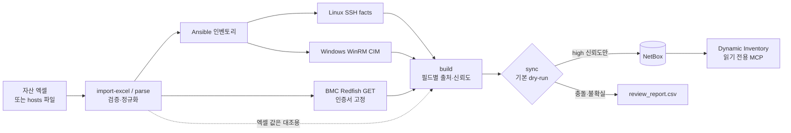

# asset-sync

**자산 엑셀(또는 hosts 파일)을 출발점으로 서버 정보를 읽기 전용으로 수집·검증하고, 확인된 값만 NetBox에 멱등하게 등록하는 IT 자산 동기화 도구**

> 이 저장소는 포트폴리오용 데모입니다. 실제 사내 환경(서버 수십 대, HPE iLO / AMI / Dell iDRAC)에 적용한 경험을 바탕으로 만들었고,
> 저장소의 모든 데이터는 **가상의 회사 "데모클라우드"** 기준으로 새로 만든 가짜 데이터입니다.
> IP는 문서용 예약 대역(RFC 5737), 시리얼은 `DEMO…` 형식이며, 실제 조직이나 장비와 관련이 없습니다.

---

## 해결하려는 문제

현업 자산 엑셀은 사람이 손으로 관리합니다. 그래서 다음과 같은 일이 흔합니다.

- hostname 칸에 이름 대신 설명이 적혀 있음 (`AHV 클러스터 노드 1`)
- 시리얼 오타, 틀린 모델명 (DL380이라고 적었지만 실제로는 DL385)
- 같은 hostname 중복, IP 오타 (`192.0.2.375`)
- 같은 시트에 **장비 비밀번호가 평문으로** 들어 있음

이 엑셀을 그대로 NetBox에 넣으면 틀린 데이터가 "정답"처럼 보이게 됩니다.
asset-sync는 **엑셀은 분류(위치·역할) 정보로만 쓰고, 사실 정보(시리얼·모델·BMC IP)는 장비에서 직접 확인한 값만** NetBox에 넣습니다.

## 데모 결과 한눈에 보기

데모 환경은 IDC 3곳(**판교 IDC** 메인 / **동탄 AI센터** GPU / **용인 DR센터**)에 랙 35개, 서버 149대, VM 57대 규모입니다.
네트워크·설비 장비 216대(Spine·Leaf·OOB 스위치, 라우터, 방화벽, L4, PDU, UPS, 항온항습기)와 VLAN·Prefix는
"네트워크·설비팀이 이미 NetBox에 관리 중인 데이터"로 미리 넣어 두고(`make seed-apply`), asset-sync는 서버만 담당합니다.

`make demo` 한 번으로 IDC별 시트 3개, 엑셀 340행(장비 단위)을 처리하면 아래와 같이 분류됩니다.

| 결과 | 대수 | 내용 |
|---|---|---|
| 자동 등록 | 133 | BMC 시리얼이 엑셀과 일치 → 이름·랙 신뢰. 이 중 131대는 랙 U 위치까지 반영. HPE / Dell / GPU 서버(HGX 베이스보드 포함) |
| 검토 대상 | 9 | 엑셀 시리얼 오타 3, 설명형 hostname 4, `test`·`localhost` 같은 일반 이름 2 |
| 수집 실패(사유 기록) | 7 | 응답 지연(timeout) 3, 인증 실패 2, 도달 불가 2 |
| 수집 대상 아님 | 57 | VM 57 (센터 간 중복 hostname 2건 포함, 하이퍼바이저 수집기는 다음 단계) |
| 제외 | 134 | 랙 안 스위치 행 101, 네트워크실 장비 26, Lustre 스토리지 2, 사무실·창고 4, IP 오타 1 |

- `make demo-apply` → 쓰기 281건 (장비 133, 이력 133, Device Type 13, 제조사 2)
- `make demo-rerun` → **쓰기 0건** (멱등성)
- 랙 U 위치는 안전할 때만 반영합니다. 엑셀 U가 이미 다른 장비(OOB 스위치)와 겹치는 2대는 장비만 등록하고 위치는 review로 보냅니다.
- `inventory/host_overrides.yml`에 `ip-192-0-2-89: {name: pg-ahv-005}`처럼 사람이 이름을 정해 주면 → 다음 실행에서 등록
- 엑셀의 `ID / PW`, `비고` 열에 넣어 둔 가짜 비밀번호는 **어떤 출력물에도 나오지 않습니다** (해당 열을 처음부터 읽지 않음)

### 화면으로 보기

**랙 배치도 (판교 IDC 서버홀 A)**: 맨 위 Leaf·OOB 스위치(노란색)는 네트워크팀 seed 데이터이고, 그 아래 서버(파란색)는
asset-sync가 엑셀 U 위치를 시리얼로 확인한 뒤 넣은 것입니다. A07의 U36이 비어 있는 이유는 pg-mon-003의 엑셀 위치(U40)가
OOB 스위치와 겹쳐 위치만 보류했기 때문입니다.


**장비 목록**: 3개 센터 349대 (서버 133 + 네트워크·전원·항온항습 216)


**장비 저널**: 어떤 값을 어디서 가져왔는지 남깁니다. 아래는 랙 위치를 `excel:판교 IDC!row185`(시리얼 확인)에서, 시리얼과 모델을 BMC Redfish에서 가져온 기록입니다.


### 다시 실행하면 쓰기 0건

```text
$ make demo-apply                         $ make demo-rerun
== APPLY result ==                        == DRY-RUN plan ==
assets: changed=133                       assets: review=9, skipped=64, unchanged=133
writes: 281                               writes: 0
   133 x create dcim/devices              review rows: 45
   133 x create extras/journal-entries
    13 x create dcim/device-types         No changes written.
     2 x create dcim/manufacturers
```

### 자동으로 넣지 않은 것 (`reports/review_report.csv`, `run_report.csv` 발췌)

| 장비 | 항목 | 사유 (도구 출력 그대로) | 해야 할 일 |
|---|---|---|---|
| pg-mon-003 | position | `U40-40 already occupied by pg-oob-a07; position not applied` | 랙을 확인하고 엑셀 또는 NetBox 수정 |
| pg-db-004 | serial | `Excel differs from collected value (DE******75 from bmc_redfish:System.SerialNumber)` | 엑셀 시리얼 수정 (이름·랙은 적용 안 함) |
| pg-k8s-w-013 | model | `Excel differs from collected value (ProLiant DL385 Gen11 …); collected value used` | 엑셀 모델명 수정 |
| ip-192-0-2-89 | hostname | `hostname not confirmed by a collector` (엑셀 칸: `AHV 클러스터 노드 5 (판교)`) | `host_overrides.yml`에서 이름 지정 |
| pg-ceph-004 / pg-esxi-004 / yi-legacy-001 | 수집 | `bmc_redfish:timeout` / `auth_failed` / `no_pinned_cert` | BMC 응답·계정·도달 여부 확인 |

시리얼은 보고서에서도 `DE******75`처럼 가려서 남깁니다.

## 아키텍처



| 구성 요소 | 역할 |
|---|---|
| `scripts/asset_sync/excelimport.py` | 병합 셀(=U 높이) 기준으로 장비 단위 해석. 비밀번호·비고·담당자 열은 **읽지 않음** |
| `scripts/asset_sync/hostsparse.py` | hosts 파일 검증 (중복 IP/이름, alias 충돌, IPv6, loopback, 잘못된 행, 마스크 불명확) |
| `scripts/asset_sync/bmc.py` | Redfish GET 전용 수집. 인증서 지문 고정, iLO 연결 끊김 대응, 실패 사유 분류 |
| `scripts/asset_sync/normalize.py` | 모든 값을 `{value, source, collected_at, confidence}`로 저장. 출처가 다르면 conflict |
| `scripts/asset_sync/sync.py` | 식별자 검증 → 신규 생성 / 빈 값만 채우기 / 나머지는 review. 삭제 코드 없음 |
| `playbooks/` | 읽기 전용 수집(Linux/Windows), NetBox 분류 체계 bootstrap, 데모용 네트워크·설비 seed (모두 check 모드 기본) |
| `demo/mock_bmc/` | 가짜 Redfish BMC 149대를 흉내 내는 컨테이너 |

## 핵심 설계 결정

**1. 확인된 값만 자동 반영합니다 (신뢰도 3단계)**
- `high`: 인증된 직접 조회 결과. 이 값만 NetBox에 씁니다.
- `medium`: 사람이 입력한 값(엑셀)이나 추정값. review로 보냅니다.
- `conflict`: 출처끼리 값이 다른 경우. 시리얼처럼 식별에 쓰는 필드라면 그 장비 전체를 보류합니다.
- 비어 있거나 의미 없는 값(`To Be Filled By O.E.M.`, `0000…`)은 버립니다. **값을 지어내지 않습니다.**

**2. 엑셀 행은 시리얼로 "검증"한 뒤에만 믿습니다**
- BMC 시리얼과 엑셀 시리얼이 같아야, 그 행이 이 장비를 가리킨다고 보고 엑셀의 hostname과 랙 정보를 씁니다.
- 시리얼이 다르면 그 엑셀 행이 다른 장비를 가리키는 것일 수 있으므로, 이름과 랙을 적용하지 않습니다.

**3. 덮어쓰지 않고, 지우지 않습니다**
- NetBox에 이미 있는 값이 수집값과 다르면 바꾸지 않고 review로 보냅니다. 빈 필드만 채웁니다.
- 삭제 기능은 없습니다. NetBox에는 있는데 수집에서 사라진 객체는 보고만 합니다.

**4. dry-run과 apply는 같은 코드 경로를 탑니다**
- 쓰기는 모두 `Writer`를 거치며, dry-run일 때는 기록만 하고 API를 부르지 않습니다. 그래서 계획과 실제 결과가 어긋나지 않습니다.
- apply는 `max_hosts` 상한과 확인 입력(`apply`)을 거쳐야 실행됩니다.

**5. 인증서 검증을 끄지 않습니다**
- BMC는 대부분 자체 서명 인증서를 씁니다. 그래서 `bmc-trust`로 장비별 인증서 지문(SHA-256)을 기록해 두고, 이후에는 정확히 그 인증서만 받아들입니다.
- 검증을 아예 끄는 방식과 달리, 중간에 다른 장비가 끼어들면 접속을 거부합니다.

**6. 랙 위치는 겹치지 않을 때만 넣습니다**
- 엑셀 U 위치는 다음 조건을 모두 만족할 때만 반영합니다: 엑셀 시리얼 = BMC 시리얼, NetBox 위치가 비어 있음,
  Device Type 높이 = 엑셀 병합 셀 높이, 랙 범위 안, 그 U를 다른 장비(이미 있는 것과 이번 실행에서 넣을 것 모두)가 쓰지 않음.
- 하나라도 어긋나면 위치만 review로 보내고 장비는 등록합니다. NetBox에 이미 있는 위치는 옮기지 않습니다.
- Device Type의 U 높이도 시리얼로 확인된 엑셀 행들이 모두 같은 값을 가질 때만 정합니다. 저널에 `position<-excel:판교 IDC!row45` 같은 출처를 남깁니다.

**7. 비밀 정보는 출력물에 남기지 않습니다**
- 토큰과 비밀번호는 `.env`(권한 600, Git 제외)에만 둡니다. 로그 출력에서는 token/password 패턴을 가립니다.
- 시리얼은 보고서에서 `DE******G5`처럼 마스킹합니다.
- NetBox 토큰은 두 개로 나눕니다. 조회·MCP·dry-run에는 읽기 전용 토큰, apply에는 쓰기 토큰을 씁니다.

## 데모 시나리오

`demo/generate_demo_data.py`가 엑셀(IDC별 시트), 가짜 BMC 응답, 네트워크·설비 seed를 함께 만들되, 일부를 일부러 어긋나게 만듭니다.
규모와 시나리오는 파일 위쪽의 `SITES`, `SCENARIOS`에서 바꿉니다.

| 센터 | 구성 |
|---|---|
| 판교 IDC | 서버홀 A/B 랙 18개 + 네트워크실 2개. 웹·API, k8s(마스터 3, 워커 24), DB, Kafka, ESXi, Nutanix AHV, Ceph — 서버 92대, VM 38대 |
| 동탄 AI센터 | 48U GPU 랙 8개 + 네트워크실. HGX H100(Cray XD670) 16, A100(Apollo 6500) 8, 로그인·관리·데이터 노드, InfiniBand — 서버 34대, VM 10대 |
| 용인 DR센터 | DR 랙 5개 + 네트워크실. 웹·DB DR, 백업, ESXi, 구형 장비 — 서버 23대, VM 9대 |

| 시나리오 | 장비 | 기대 동작 |
|---|---|---|
| 정상 (HPE iLO) | pg-web-001 … | 자동 등록, 랙 U 배치 |
| Dell iDRAC, 제조사 표기 `Dell Inc.` | pg-kafka-*, pg-esxi-*, yi-esxi-* | 제조사 별칭 규칙으로 `Dell`에 통합 |
| GPU 베이스보드가 별도 System으로 보임 | dt-gpu-h100-* | 시리얼·모델이 있는 본체 System만 선택 |
| 엑셀 모델명이 실제와 다름 | pg-k8s-w-013, pg-app-007 | 실제 모델(DL385 등)로 등록하고 엑셀 오류는 review |
| 같은 제품을 다른 이름으로 표기 | dt-gpu-a100-* | Apollo 6500 ↔ XL675d 차이를 review |
| 엑셀 시리얼 오타 | pg-db-004, dt-gpu-h100-011, yi-backup-002 | 이름·랙 미적용, 보류 |
| 설명형 hostname / `test`·`localhost` | pg-ahv-005~008 / 2대 | 보류 → 사람이 이름을 지정하면 등록 |
| 엑셀 U가 스위치와 겹침 | pg-mon-003, dt-mgmt-002 | 장비는 등록, 위치만 review (`occupied by pg-oob-a07`) |
| 같은 VM 이름이 두 센터 시트에 | vm-jenkins | 둘 다 duplicate로 보류 |
| 응답 지연 / 인증 실패 / 도달 불가 | pg-ceph-004·007, dt-data-005 / pg-esxi-004, yi-esxi-003 / yi-legacy-001~002 | `timeout` / `auth_failed` / `no_pinned_cert`로 기록 |
| 스위치·방화벽·스토리지, 네트워크실·사무실·창고 장비, IP 오타 | — | 가져오기 단계에서 제외 |

## 빠르게 실행하기

**준비물**: Linux, Docker와 Compose v2, Python 3.11 이상, 메모리 4GB 이상, 인터넷(이미지와 패키지 다운로드)

<details>
<summary>Rocky Linux 9 준비 (VMware VM에서 검증, root 권한 필요)</summary>

```bash
# Docker CE + Compose v2 (podman/runc가 설치돼 있으면 충돌하므로 먼저 제거: dnf remove podman buildah runc)
sudo dnf -y install dnf-plugins-core
sudo dnf config-manager --add-repo https://download.docker.com/linux/rhel/docker-ce.repo
sudo dnf -y install docker-ce docker-ce-cli containerd.io docker-buildx-plugin docker-compose-plugin
sudo systemctl enable --now docker

# Python 3.12 (Makefile이 python3.12를 우선 사용. 기본 python3는 3.9라 쓰지 않음)
sudo dnf -y install python3.12 git make openssl

# 다른 PC(예: Windows 호스트 브라우저)에서 접속할 때만: 80(→443 리다이렉트), 443
sudo firewall-cmd --permanent --zone=public --add-service=http --add-service=https
sudo firewall-cmd --reload

# root가 아닌 사용자로 실행할 때
sudo usermod -aG docker "$USER"                          # 다시 로그인 필요
sudo install -d -o "$USER" -g "$USER" /opt/netbox-docker
```

`.env`에서 `NETBOX_PUBLIC_IP`와 `NETBOX_URL`(`https://<VM IP>`)을 VM IP로 바꾼 뒤 `make netbox`를 실행합니다.
인증서 SAN에 이 IP가 들어가므로 `NETBOX_VERIFY_TLS=true`를 그대로 쓸 수 있습니다.
</details>

```bash
git clone asset-sync.bundle asset-sync && cd asset-sync
make setup            # venv + 의존성 + Ansible collection
make env              # .env.example → .env (데모 기본값)
make netbox           # 공식 netbox-docker 배포 (첫 기동 시 마이그레이션 4~6분)
make netbox-init      # 관리자 계정 + 쓰기/읽기 토큰 → .env
make bootstrap-apply  # Region / Site / Location / Rack / Role / Cluster / 커스텀 필드
make demo-data mock-bmc
make seed-apply       # 데모용 네트워크·설비 장비 216대 + VLAN / Prefix (약 4분)
make demo             # 가져오기 → 인증서 고정 → 수집 → 대조 → dry-run 계획 → 보고
make demo-apply       # 확인 프롬프트에 apply 입력 (데모 상한 DEMO_MAX_HOSTS=200)
make demo-rerun       # 쓰기 0건 확인
```

- **NetBox 접속**: 브라우저로 `https://127.0.0.1`에 접속합니다. 계정은 `admin`, 비밀번호는 `demo/.netbox_admin`에 있습니다.
- **다른 PC에서 보려면**: `.env`의 `NETBOX_PUBLIC_IP`와 `NETBOX_URL`을 VM IP로 바꾸고 `make netbox`를 실행합니다 (방화벽 80/443 필요).
- **`/opt`에 쓸 권한이 없으면**: `.env`의 `NETBOX_DOCKER_DIR`를 `$HOME/netbox-docker` 등으로 바꾸고, `NETBOX_CA_BUNDLE`도 같은 경로로 맞춥니다.
- **결과물 위치**
  - `reports/sync_plan_*.md`: 계획
  - `reports/review_report.csv`: 검토 목록
  - `reports/run_report.csv`: 성공 / 실패 / 미확인 / 중복 집계
- **단위 테스트**: `make test`로 실행합니다. 인메모리 Fake NetBox로 돌기 때문에 서버나 NetBox가 필요 없습니다.

**데모 재현 시 보이는 메시지** (Rocky 9.8 VM, netbox-docker 5.1.1 / NetBox 4.7, Docker 29에서 재현)

| 증상 | 원인 | 조치 |
|---|---|---|
| 브라우저에서 인증서 경고 | 배포 시 만든 자체 서명 인증서 | `/opt/netbox-docker/proxy/certs/netbox.crt`를 클라이언트 PC의 "신뢰할 수 있는 루트 인증 기관"에 가져오기 |
| `make bootstrap` / `make seed`(check 모드)에서 `Could not resolve id` | 미리보기라 상위 객체(Site, Manufacturer, Device type)가 아직 없음 | 정상. apply에서는 순서대로 생성되고, 실패하면 오류로 멈춤 |
| `make netbox-init`에서 `LOGIN_REQUIRED is deprecated` 경고 | netbox-docker 기본 설정이 NetBox 4.7에서 폐기 예정인 항목을 씀 | 동작에 영향 없음 |
| `curl https://198.51.100.x/...`가 인증서 오류(60) | 가짜 BMC도 자체 서명 인증서 | 정상. asset-sync는 `bmc-trust`로 기록한 지문만 허용(`BMC_VERIFY_TLS=pin`) |
| `demo-apply`의 `review rows`(12)가 dry-run(45)보다 적음 | apply는 변경 대상 133대만 다시 처리 | 정상. 전체 목록은 `reports/review_report.csv`, apply분은 `review_report_apply_*.csv` |
| `make demo`의 BMC 단계가 30초 이상 멈춘 듯 보임 | 응답 지연 시나리오 3대가 timeout(15초 + 재시도)까지 기다림 | 정상. `timeout`으로 기록되고 나머지는 병렬로 끝남 |

## 실제 환경에 적용하며 겪은 문제와 해결

| 증상 | 원인 | 해결 |
|---|---|---|
| HPE iLO에서 첫 요청만 성공하고 이후 `unreachable` | iLO가 응답 후 연결을 예고 없이 끊음. 클라이언트가 끊긴 연결을 재사용 | `Connection: close` 사용, GET에만 짧은 재시도, 오류를 `connection_dropped`로 분류 |
| 같은 기종 일부가 계속 `unreachable` | 실제로는 응답 지연(read timeout)인데, 재시도 후 `ConnectionError`로 감싸져 잘못 분류됨 | 원인 문자열로 `timeout`을 구분하고, 지연이 큰 BMC용 `--timeout` 옵션 추가 |
| GPU 서버의 시리얼과 모델이 비어 있음 | Redfish에 GPU 베이스보드가 System으로 하나 더 보임 | 시리얼과 모델이 있는 본체 System을 선택. 본체 후보가 둘 이상이면 아무 값도 쓰지 않음 |
| 자체 서명 인증서라 검증 실패 | BMC 기본 인증서 | 검증을 끄지 않고 인증서 지문 고정(pinning)으로 해결 |
| SSH 계정·키 설정이 적용되지 않음 | 생성된 인벤토리 파일과 `group_vars`가 다른 디렉터리에 있었음 | 생성 인벤토리를 `inventory/` 바로 아래로 이동 |
| dry-run의 Device Type 생성 수가 실제보다 많음 | 계획 단계에서 생성 예정 객체를 캐시하지 않아 장비마다 중복 집계 | 생성 예정 객체도 캐시해 계획과 실제 결과를 일치시킴 |
| apply 후 검토 목록이 줄어듦 | apply가 변경 대상 장비만 다시 돌면서 전체 목록을 덮어씀 | apply 결과는 별도 파일로 저장 |
| NetBox 4.7 토큰이 403 (`Invalid v1 token`) | v2 토큰은 응답의 key와 token을 조합해야 함 | `nbt_<key>.<token>` 형식으로 조합 |
| 엑셀 구조를 확인하는 출력에 비밀번호가 보임 | 공백이 들어간 값(`admin / …`)을 마스킹 규칙이 놓침 | 가져오기 단계에서 해당 열을 아예 읽지 않도록 설계 변경 |
| `localhost`라는 이름의 장비가 생길 뻔함 | 엑셀 hostname 칸에 `localhost`나 `test`가 적힌 서버 | 일반 이름은 신뢰하지 않고, 사람이 `host_overrides.yml`에서 이름을 지정하도록 함 |

## 디렉터리 구조

```
scripts/assetctl.py          CLI: parse, import-excel, bmc-trust, bmc, build, check, sync, report
scripts/asset_sync/          파서, 엑셀 가져오기, BMC 수집, 정규화, NetBox 클라이언트, 동기화 엔진
scripts/deploy_netbox.sh     netbox-docker 배포 (기본 dry-run, nginx TLS 프록시, Postgres/Granian 튜닝)
scripts/backup_netbox.sh     pg_dump + media + env 백업과 보관 기간 관리
scripts/setup_mcp.sh         netboxlabs/netbox-mcp-server(읽기 전용) 설치, .mcp.json 생성
playbooks/                   읽기 전용 수집, NetBox bootstrap, 데모 네트워크·설비 seed (check 모드 기본)
inventory/                   group_vars, host_overrides.yml, netbox.yml (dynamic inventory)
config/settings.yml          분류 체계, 엑셀 규칙, 제조사 별칭, 동기화 정책
deploy/systemd/              주기 동기화(기본 dry-run 보고)와 백업 타이머
demo/                        데모 데이터 생성기, 가짜 Redfish BMC, NetBox 초기화 스크립트
tests/                       단위 테스트 44개, 인메모리 Fake NetBox
docs/운영가이드.md            실제 환경 운영 가이드 (hosts 파싱 규칙, 반영 규칙, 보안)
docs/images/                 README 스크린샷 (랙 배치도, 장비 목록, 저널)
```

## 한계와 다음 단계

- **VM**: 하이퍼바이저 API 수집기(Nutanix Prism, Proxmox, vCenter)가 아직 없습니다. 데모에서 VM은 가져오기만 하고 수집은 건너뜁니다.
- **랙 앞/뒤 면**: 위치를 넣을 때 면은 `front`로 고정합니다. 반깊이 장비를 뒷면에 다는 구성은 사람이 지정해야 합니다.
- **케이블·전원**: 스위치 포트–서버 NIC 케이블, PDU–서버 전원 연결, Power Feed는 아직 다루지 않습니다. LLDP 수집이 붙으면 케이블을 자동화할 수 있습니다.
- **테넌트**: 서비스·조직별 Tenant 지정은 엑셀에 해당 열이 없어 비워 둡니다.
- **OS 정보**: OS 버전, 실제 NIC 이름, primary IP는 SSH/WinRM 수집이 있어야 채워집니다. 플레이북과 정규화 코드는 구현돼 있지만 데모에서는 BMC 수집만 시연합니다.
- **BMC 계정**: 서버마다 다른 BMC 계정(예: DGX 전용 계정)을 쓰는 기능은 아직 없습니다.
