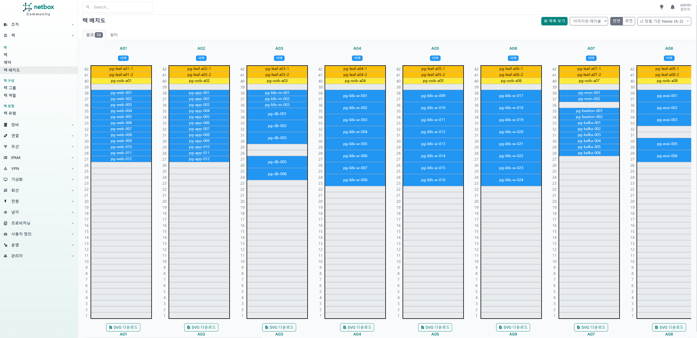
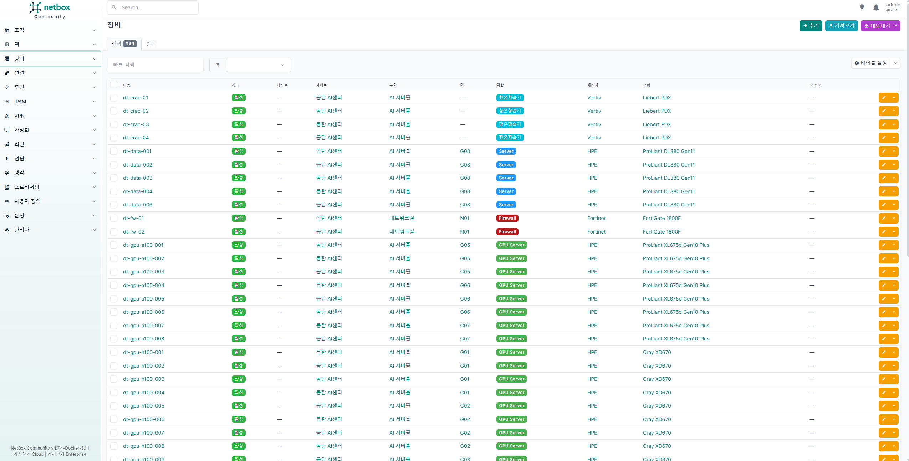
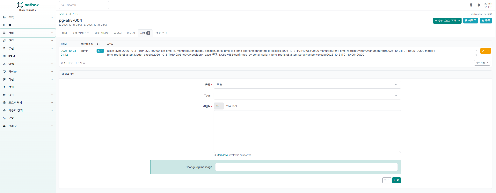
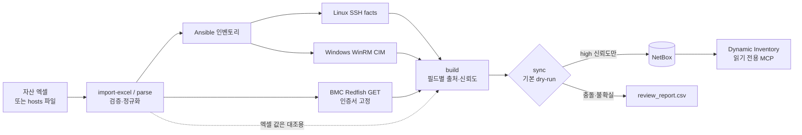

# asset-sync

자산 엑셀(또는 hosts 파일)을 기준으로 서버 정보를 읽기 전용으로 수집하고, 장비에서 직접 확인한 값만 NetBox에 넣는 도구.

> 포트폴리오용 데모 저장소다. 회사에서 서버 수십 대(HPE iLO, AMI, Dell iDRAC)에 적용했던 경험을 바탕으로 다시 만들었고,
> 데이터는 전부 가상의 회사 "데모클라우드" 기준 가짜 데이터다. IP는 문서용 대역(RFC 5737), 시리얼은 `DEMO…` 형식이다.

## 왜 만들었나

자산 엑셀은 사람이 손으로 관리하다 보니 이런 게 늘 섞여 있다.

- hostname 칸에 이름 대신 설명이 적혀 있다 (`AHV 클러스터 노드 1`)
- 시리얼 오타, 틀린 모델명 (DL380이라고 적었는데 실제로는 DL385)
- 중복 hostname, IP 오타 (`192.0.2.375`)
- 같은 시트에 장비 비밀번호가 평문으로 들어 있다

이걸 그대로 NetBox에 옮기면 틀린 값이 정답처럼 보이게 된다. 그래서 엑셀은 위치나 역할 같은 분류 정보로만 쓰고,
시리얼·모델·BMC IP 같은 사실 정보는 장비(BMC, OS)에서 직접 읽은 값만 넣도록 했다.

## 데모 결과

데모 환경은 판교 IDC(메인), 동탄 AI센터(GPU), 용인 DR센터 3곳에 랙 35개, 서버 149대, VM 57대다.
스위치·라우터·방화벽·L4·PDU·UPS·항온항습기 216대와 VLAN/Prefix는 네트워크·설비팀이 이미 NetBox에 넣어 둔 데이터라고 가정하고
`make seed-apply`로 미리 채운다. asset-sync가 다루는 건 서버뿐이다.

`make demo`로 IDC별 시트 3개(엑셀 340행)를 처리한 결과:

| 결과 | 대수 | 비고 |
|---|---|---|
| 자동 등록 | 133 | BMC 시리얼과 엑셀 시리얼이 일치한 서버. 그중 131대는 랙 U 위치까지 들어감 |
| 검토 대상 | 9 | 엑셀 시리얼 오타 3, 설명형 hostname 4, `test`/`localhost` 2 |
| 수집 실패 | 7 | timeout 3, 인증 실패 2, 도달 불가 2 (사유는 보고서에 남음) |
| 수집 안 함 | 57 | VM. 하이퍼바이저 수집기는 아직 없다. 센터 간 중복 이름 2건 포함 |
| 제외 | 134 | 랙 안 스위치 행 101, 네트워크실 장비 26, Lustre 스토리지 2, 사무실·창고 4, IP 오타 1 |

`make demo-apply`로 281건(장비 133, 저널 133, Device Type 13, 제조사 2)을 쓰고, 바로 다시 돌리면 0건이다.

엑셀 U 위치가 OOB 스위치와 겹치는 서버 2대는 장비만 등록하고 위치는 비워 둔 채 검토로 넘긴다.
설명형 hostname은 `inventory/host_overrides.yml`에 `ip-192-0-2-89: {name: pg-ahv-005}`처럼 이름을 적어 주면 다음 실행 때 등록된다.
엑셀의 `ID / PW`, `비고` 열은 아예 읽지 않기 때문에 거기 적힌 비밀번호는 어떤 출력에도 나오지 않는다.

### 스크린샷

판교 IDC 서버홀 A 랙 배치도. 위쪽 노란색 Leaf/OOB 스위치는 seed 데이터고, 아래 파란색 서버가 asset-sync가 넣은 것이다.
A07의 U36이 비어 있는 건 pg-mon-003의 엑셀 위치(U40)가 OOB 스위치 자리와 겹쳐서 위치를 넣지 않았기 때문이다.



장비 목록 (3개 센터 349대: 서버 133 + 네트워크·전원·항온항습 216)



장비마다 저널에 값의 출처가 남는다. 이 서버는 랙 위치를 엑셀 `판교 IDC` 시트 185행에서(시리얼 확인 후), 시리얼과 모델은 BMC Redfish에서 가져왔다.



### 다시 돌려도 바뀌는 게 없다

```text
$ make demo-apply                         $ make demo-rerun
== APPLY result ==                        == DRY-RUN plan ==
assets: changed=133                       assets: review=9, skipped=64, unchanged=133
writes: 281                               writes: 0
   133 x create dcim/devices              review rows: 45
   133 x create extras/journal-entries
    13 x create dcim/device-types         No changes written.
     2 x create dcim/manufacturers
```

### 자동으로 넣지 않은 것

`reports/review_report.csv`, `run_report.csv`에서 종류별로 하나씩 뽑았다. 사유는 도구 출력 그대로다.

| 장비 | 항목 | 사유 | 할 일 |
|---|---|---|---|
| pg-mon-003 | position | `U40-40 already occupied by pg-oob-a07; position not applied` | 랙 확인 후 엑셀이나 NetBox 수정 |
| pg-db-004 | serial | `Excel differs from collected value (DE******75 from bmc_redfish:System.SerialNumber)` | 엑셀 시리얼 수정. 이름·랙은 적용 안 함 |
| pg-k8s-w-013 | model | `Excel differs from collected value (ProLiant DL385 Gen11 …); collected value used` | 엑셀 모델명 수정 |
| ip-192-0-2-89 | hostname | `hostname not confirmed by a collector` (엑셀 칸: `AHV 클러스터 노드 5 (판교)`) | `host_overrides.yml`에 이름 지정 |
| pg-ceph-004 외 2대 | 수집 | `bmc_redfish:timeout` / `auth_failed` / `no_pinned_cert` | BMC 응답, 계정, 도달 여부 확인 |

보고서의 시리얼은 `DE******75`처럼 가려서 남긴다.

## 구조



- `excelimport.py`: 병합 셀 하나를 장비 하나로 보고, 병합된 행 수를 U 높이로 쓴다. 비밀번호·비고·담당자 열은 읽지 않는다.
- `hostsparse.py`: hosts 파일 검증 (중복 IP/이름, alias 충돌, IPv6, loopback, 마스크 없는 행 등)
- `bmc.py`: Redfish GET만 한다. 인증서 지문 고정, iLO 연결 끊김 처리, 실패 사유 분류
- `normalize.py`: 모든 값을 `{value, source, collected_at, confidence}`로 저장하고, 출처끼리 값이 다르면 conflict로 표시
- `sync.py`: 식별자 확인 후 새로 만들기 / 빈 칸만 채우기 / 나머지는 review. 삭제 코드는 없다.
- `playbooks/`: 읽기 전용 수집(Linux/Windows), NetBox 분류 bootstrap, 데모용 seed. 전부 기본은 check 모드다.
- `demo/mock_bmc/`: 가짜 Redfish BMC 149대를 띄우는 컨테이너

## 설계하면서 정한 것들

**확인된 값만 쓴다.** 값마다 신뢰도를 붙인다. BMC나 OS에 인증해서 직접 읽은 값은 `high`, 엑셀처럼 사람이 적은 값이나 추정값은 `medium`,
출처끼리 다르면 `conflict`다. NetBox에는 `high`만 쓰고 나머지는 검토 목록으로 보낸다. 시리얼처럼 식별에 쓰는 값이 conflict면 그 장비는 통째로 보류한다.
`To Be Filled By O.E.M.`, `0000…` 같은 의미 없는 값은 버린다.

**엑셀 행은 시리얼로 맞춰 본 뒤에만 믿는다.** BMC 시리얼과 엑셀 시리얼이 같아야 그 행이 이 장비라고 보고 hostname과 랙 정보를 쓴다.
시리얼이 다르면 엑셀 행이 다른 장비 것일 수도 있으니 이름과 랙은 건드리지 않는다.

**덮어쓰지도, 지우지도 않는다.** NetBox에 이미 값이 있는데 수집값과 다르면 그대로 두고 검토로 보낸다. 빈 칸만 채운다.
NetBox엔 있는데 수집에서 안 보이는 장비도 보고만 한다.

**dry-run과 apply는 같은 코드를 탄다.** 쓰기는 전부 `Writer`를 거치고, dry-run일 때는 API를 부르지 않고 기록만 한다.
그래서 계획과 실제 결과가 어긋날 일이 없다. apply는 `max_hosts` 상한을 넘으면 멈추고, 프롬프트에 `apply`를 쳐야 진행된다.

**인증서 검증은 끄지 않는다.** BMC는 대부분 자체 서명 인증서라 `verify=False`로 넘기기 쉬운데, 그러면 중간에 다른 장비가 끼어들어도 모른다.
대신 `bmc-trust`로 장비별 인증서 SHA-256 지문을 기록해 두고 그 인증서만 받는다.

**랙 위치는 겹치지 않을 때만 넣는다.** 조건은 이렇다. 엑셀 시리얼과 BMC 시리얼이 같고, NetBox에 위치가 비어 있고,
Device Type 높이가 엑셀 병합 셀 높이와 같고, 그 U 범위를 다른 장비(이미 있는 것 + 이번 실행에 넣을 것)가 안 쓰고 있어야 한다.
하나라도 안 맞으면 장비만 등록하고 위치는 검토로 보낸다. 이미 들어가 있는 위치는 옮기지 않는다.

**비밀 정보는 출력에 남기지 않는다.** 토큰과 비밀번호는 `.env`(600, Git 제외)에만 두고, 로그에서는 token/password 패턴을 가린다.
NetBox 토큰은 읽기 전용(조회·MCP·dry-run)과 쓰기용(apply)을 따로 쓴다.

## 데모 시나리오

`demo/generate_demo_data.py`가 엑셀(IDC별 시트), 가짜 BMC 응답, seed 데이터를 한꺼번에 만든다. 일부는 일부러 어긋나게 만들어 둔다.
규모나 시나리오를 바꾸려면 파일 위쪽 `SITES`, `SCENARIOS`를 고치면 된다.

- 판교 IDC: 서버홀 A/B 랙 18개 + 네트워크실 2개. 웹/API, k8s(마스터 3, 워커 24), DB, Kafka, ESXi, Nutanix AHV, Ceph. 서버 92대, VM 38대
- 동탄 AI센터: 48U GPU 랙 8개 + 네트워크실. HGX H100(Cray XD670) 16대, A100(Apollo 6500) 8대, 로그인·관리·데이터 노드, InfiniBand. 서버 34대, VM 10대
- 용인 DR센터: 랙 5개 + 네트워크실. 웹/DB DR, 백업, ESXi, 구형 장비. 서버 23대, VM 9대

일부러 넣은 예외:

| 상황 | 장비 | 결과 |
|---|---|---|
| Dell 제조사가 `Dell Inc.`로 보고됨 | pg-kafka-\*, pg-esxi-\*, yi-esxi-\* | 별칭 규칙으로 `Dell`에 합침 |
| GPU 베이스보드가 별도 System으로 보임 | dt-gpu-h100-\* | 시리얼·모델이 있는 본체 System만 사용 |
| 엑셀 모델명이 틀림 | pg-k8s-w-013, pg-app-007 | 실제 모델로 등록, 엑셀 오류는 검토 |
| 같은 제품을 다른 이름으로 적음 | dt-gpu-a100-\* | Apollo 6500 / XL675d 차이를 검토로 |
| 엑셀 시리얼 오타 | pg-db-004, dt-gpu-h100-011, yi-backup-002 | 이름·랙 적용 안 하고 보류 |
| 설명형 hostname, `test`/`localhost` | pg-ahv-005~008 외 2대 | 보류. 이름을 지정해 주면 등록 |
| 엑셀 U가 스위치와 겹침 | pg-mon-003, dt-mgmt-002 | 장비는 등록, 위치만 검토 |
| 같은 VM 이름이 두 센터 시트에 있음 | vm-jenkins | 둘 다 중복으로 보류 |
| 응답 지연 / 인증 실패 / 도달 불가 | pg-ceph-004·007, dt-data-005 / pg-esxi-004, yi-esxi-003 / yi-legacy-001~002 | `timeout` / `auth_failed` / `no_pinned_cert`로 기록 |

## 실행

필요한 것: Linux, Docker + Compose v2, Python 3.11 이상, 메모리 4GB 이상, 인터넷(이미지·패키지 다운로드)

<details>
<summary>Rocky Linux 9에서 준비 (VMware VM에서 확인, root 권한 필요)</summary>

```bash
# Docker CE + Compose v2 (podman/runc가 있으면 충돌하니 먼저 지운다: dnf remove podman buildah runc)
sudo dnf -y install dnf-plugins-core
sudo dnf config-manager --add-repo https://download.docker.com/linux/rhel/docker-ce.repo
sudo dnf -y install docker-ce docker-ce-cli containerd.io docker-buildx-plugin docker-compose-plugin
sudo systemctl enable --now docker

# Python 3.12 (기본 python3는 3.9라서 Makefile이 python3.12를 먼저 찾는다)
sudo dnf -y install python3.12 git make openssl

# 다른 PC(예: Windows 호스트 브라우저)에서 볼 때만: 80(443으로 리다이렉트), 443
sudo firewall-cmd --permanent --zone=public --add-service=http --add-service=https
sudo firewall-cmd --reload

# root가 아닌 계정으로 돌릴 때
sudo usermod -aG docker "$USER"                          # 다시 로그인해야 적용됨
sudo install -d -o "$USER" -g "$USER" /opt/netbox-docker
```

`.env`의 `NETBOX_PUBLIC_IP`와 `NETBOX_URL`(`https://<VM IP>`)을 VM IP로 바꾸고 `make netbox`를 실행한다.
인증서 SAN에 그 IP가 들어가서 `NETBOX_VERIFY_TLS=true`를 그대로 쓸 수 있다.
</details>

```bash
git clone https://github.com/yonjaek/asset-sync.git && cd asset-sync
make setup            # venv, 의존성, Ansible collection
make env              # .env.example -> .env
make netbox           # netbox-docker 배포 (첫 기동 때 마이그레이션 4~6분)
make netbox-init      # 관리자 계정, 쓰기/읽기 토큰 -> .env
make bootstrap-apply  # Region, Site, Location, Rack, Role, Cluster, 커스텀 필드
make demo-data mock-bmc
make seed-apply       # 네트워크·설비 장비 216대 + VLAN/Prefix (4분 정도)
make demo             # 엑셀 가져오기, 인증서 고정, 수집, 대조, dry-run 계획, 보고
make demo-apply       # 프롬프트에 apply 입력 (데모용 상한 DEMO_MAX_HOSTS=200)
make demo-rerun       # 쓰기 0건인지 확인
```

- 접속은 `https://127.0.0.1`, 계정은 `admin`, 비밀번호는 `demo/.netbox_admin`에 있다.
- 다른 PC에서 보려면 `.env`의 `NETBOX_PUBLIC_IP`, `NETBOX_URL`을 VM IP로 바꾸고 `make netbox` (방화벽 80/443 필요)
- `/opt`에 쓸 권한이 없으면 `.env`의 `NETBOX_DOCKER_DIR`를 `$HOME/netbox-docker` 등으로 바꾸고 `NETBOX_CA_BUNDLE`도 같이 맞춘다.
- 결과는 `reports/`에 남는다. 계획은 `sync_plan_*.md`, 검토 목록은 `review_report.csv`, 성공/실패/미확인/중복 집계는 `run_report.csv`.
- `make test`는 인메모리 Fake NetBox로 돌아서 서버나 NetBox 없이 실행된다.

Rocky 9.8 VM(netbox-docker 5.1.1 / NetBox 4.7, Docker 29)에서 데모를 돌리면 아래 메시지들이 보이는데 모두 정상이다.

| 보이는 것 | 이유 |
|---|---|
| 브라우저 인증서 경고 | 배포 때 만든 자체 서명 인증서. `/opt/netbox-docker/proxy/certs/netbox.crt`를 클라이언트의 신뢰할 수 있는 루트 인증 기관에 넣으면 사라진다 |
| `make bootstrap` / `make seed`(check 모드)에서 `Could not resolve id` | 미리보기라 상위 객체(Site, Manufacturer, Device type)가 아직 없어서. apply에서는 순서대로 만들어지고, 실패하면 멈춘다 |
| `make netbox-init`의 `LOGIN_REQUIRED is deprecated` 경고 | netbox-docker 기본 설정 항목이 NetBox 4.7에서 폐기 예정이라 나온다. 동작과는 무관 |
| `curl https://198.51.100.x/...` 인증서 오류(60) | 가짜 BMC도 자체 서명 인증서다. asset-sync는 `bmc-trust`로 기록한 지문만 받는다 |
| `demo-apply`의 review rows(12)가 dry-run(45)보다 적음 | apply는 바뀌는 133대만 다시 처리한다. 전체 목록은 `review_report.csv`, apply분은 `review_report_apply_*.csv` |
| `make demo`의 BMC 단계가 30초쯤 멈춘 것처럼 보임 | 응답 지연 시나리오 3대가 timeout(15초 + 재시도)까지 기다린다. 나머지는 병렬로 끝난다 |

## 실제 환경에서 부딪힌 문제

- HPE iLO에서 첫 요청만 되고 그다음부터 `unreachable`이 났다. iLO가 응답 후 연결을 예고 없이 끊는데 클라이언트가 그 연결을 재사용하고 있었다.
  `Connection: close`로 바꾸고 GET에만 짧은 재시도를 넣었다. 이 경우는 `connection_dropped`로 따로 분류한다.
- 같은 기종 몇 대가 계속 `unreachable`로 찍혔는데 실제로는 응답 지연(read timeout)이었다. 재시도 후 `ConnectionError`로 감싸지면서 잘못 분류된 것.
  원인 문자열로 `timeout`을 구분하고, 느린 BMC용으로 `--timeout` 옵션을 추가했다.
- GPU 서버의 시리얼과 모델이 비어 들어왔다. Redfish에 GPU 베이스보드가 System으로 하나 더 잡혀서다.
  시리얼과 모델이 있는 본체 System만 쓰고, 본체 후보가 둘 이상이면 아무 값도 쓰지 않는다.
- BMC 자체 서명 인증서 때문에 검증이 실패했다. 검증을 끄는 대신 지문 고정으로 해결했다.
- SSH 계정·키 설정이 안 먹었다. 생성된 인벤토리 파일과 `group_vars`가 다른 디렉터리에 있었다. 생성 인벤토리를 `inventory/` 바로 아래로 옮겼다.
- dry-run에서 Device Type 생성 수가 실제보다 많게 나왔다. 계획 단계에서 생성 예정 객체를 캐시하지 않아 장비마다 중복으로 셌다. 예정 객체도 캐시하게 바꿨다.
- apply 후 검토 목록이 줄어들었다. apply가 바뀌는 장비만 다시 돌면서 전체 목록을 덮어썼다. apply 결과는 별도 파일로 저장한다.
- NetBox 4.7에서 토큰이 403(`Invalid v1 token`)을 냈다. v2 토큰은 응답의 key와 token을 `nbt_<key>.<token>`으로 합쳐야 한다.
- 엑셀 구조를 확인하려고 찍은 출력에 비밀번호가 보였다. `admin / …`처럼 공백이 들어간 값을 마스킹 규칙이 놓쳤다.
  가리는 것보다 아예 안 읽는 게 맞다고 보고, 가져오기 단계에서 해당 열을 읽지 않게 바꿨다.
- `localhost`라는 이름의 장비가 생길 뻔했다. 엑셀 hostname 칸에 `localhost`, `test`가 적힌 서버가 있었다.
  이런 일반 이름은 믿지 않고 `host_overrides.yml`에서 사람이 이름을 정하게 했다.

## 디렉터리

```
scripts/assetctl.py          CLI: parse, import-excel, bmc-trust, bmc, build, check, sync, report
scripts/asset_sync/          파서, 엑셀 가져오기, BMC 수집, 정규화, NetBox 클라이언트, 동기화
scripts/deploy_netbox.sh     netbox-docker 배포 (기본 dry-run, nginx TLS 프록시, Postgres/Granian 튜닝)
scripts/backup_netbox.sh     pg_dump + media + env 백업, 보관 기간 관리
scripts/setup_mcp.sh         netboxlabs/netbox-mcp-server(읽기 전용) 설치, .mcp.json 생성
playbooks/                   읽기 전용 수집, NetBox bootstrap, 데모 seed (check 모드 기본)
inventory/                   group_vars, host_overrides.yml, netbox.yml (dynamic inventory)
config/settings.yml          분류 체계, 엑셀 규칙, 제조사 별칭, 동기화 정책
deploy/systemd/              주기 동기화(기본 dry-run 보고)와 백업 타이머
demo/                        데모 데이터 생성기, 가짜 Redfish BMC, NetBox 초기화 스크립트
tests/                       단위 테스트 44개, 인메모리 Fake NetBox
docs/운영가이드.md            실제 환경 운영 가이드 (hosts 파싱 규칙, 반영 규칙, 보안)
docs/images/                 README 스크린샷
```

## 아직 안 된 것

- VM: 하이퍼바이저 API 수집기(Nutanix Prism, Proxmox, vCenter)가 없다. 데모에서 VM은 가져오기만 하고 수집은 건너뛴다.
- 랙 면: 위치를 넣을 때 면은 `front`로 고정이다. 반깊이 장비를 뒷면에 다는 경우는 사람이 지정해야 한다.
- 케이블·전원: 스위치 포트와 서버 NIC 사이 케이블, PDU 전원 연결, Power Feed는 아직 안 다룬다. LLDP 수집을 붙이면 케이블은 자동화할 수 있을 것 같다.
- 테넌트: 엑셀에 서비스/조직 열이 없어서 비워 둔다.
- OS 정보: OS 버전, 실제 NIC 이름, primary IP는 SSH/WinRM 수집이 있어야 채워진다. 플레이북과 정규화 코드는 있지만 데모에서는 BMC 수집만 보여 준다.
- BMC 계정: 서버마다 다른 BMC 계정(예: DGX 전용 계정)을 쓰는 건 아직 지원하지 않는다.
